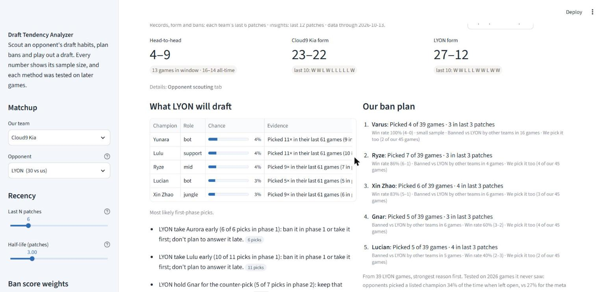
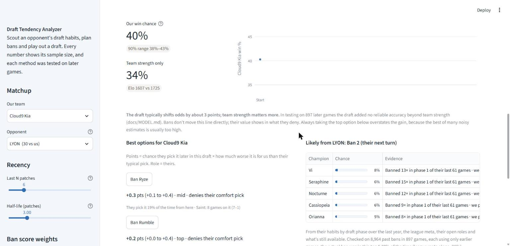
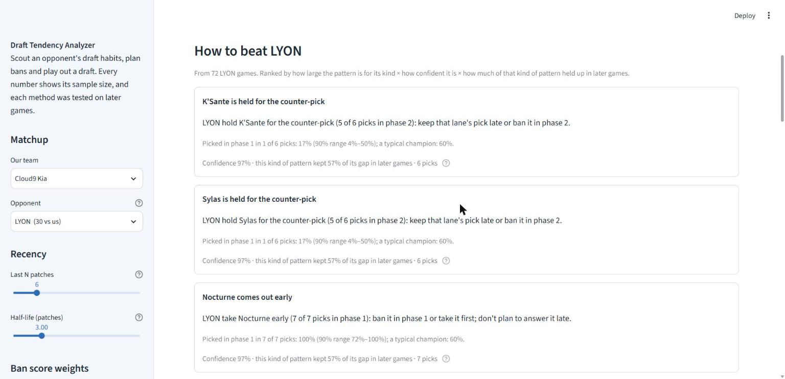

# Draft Tendency Analyzer

**Category 2: LoL macro scouting & draft management, for Cloud9 coaches.**

A draft-prep dashboard built on GRID's official pro match data. It tells a coach what an opponent will draft, what to ban, and how to beat them. **It only shows advice that held up on games it had never seen.**

| Tested on games it never saw | Result |
|---|---|
| **Ban plan**: does the opponent actually play what we tell you to ban? | They picked a listed champion **34%** of the time when it was left open, vs **27%** for the league meta's top 5. That covers 439 games from 2026, with weights tuned on 2025 only. |
| **Likely picks**: can we call their next pick? | Their actual next pick was in our top 5 **44%** of the time, vs **37%** for the meta. That covers 897 games, each predicted from earlier games only. |
| **Only advice that held up is shown** | Each kind of pattern was re-measured on later games. Draft habits ("they take Nocturne early") pointed the same way **82%** of the time, so they are shown. Win-rate splits by side, first pick or Fearless carry-over were coin flips, so they are not. |

One honest negative result: the draft does not predict *who wins* beyond team strength. That's why the simulator shows what each choice shifts, never a forecast. Every number is in [docs/VALIDATION.md](docs/VALIDATION.md).

**Demo video:** [link coming]

## Features

Tabs, in order:

- **Match prep:** the 60-second brief before a match. **Export pre-match report** saves it as a one-page, text-only HTML file that prints cleanly to PDF. It contains:
  - head-to-head and recent form;
  - what they'll draft (most likely first-phase picks and their phase tells);
  - our top 5 bans, strongest reason first;
  - the top 3 "how to beat them" cards;
  - what they ban against us, and our own predictable habits.
- **Draft simulator:** a 20-slot pro draft, with first pick and side set separately (2026 "first selection"). Also: game number with Fearless-locked champions, and editable lineups and roles. At every step it shows:
  - our win chance with a 90% range, next to team strength alone, plus a chart of how it moved;
  - the best 5 options, with their shift in points and the evidence;
  - the opponent's 5 most likely next picks or bans.
- **Opponent scouting:** the champion pool by inferred role with W–L records, priority picks, bans by phase, and a short **Early game** section (first blood, dragon, void grub, herald, tower). That section lists only patterns that held up in later games.
- **Insights:** "How to beat <opponent>" cards (ban impact, comfort dependency, phase tells and more). Each card shows its evidence with a Wilson 90% interval, a confidence level and its sample size. Only kinds of pattern that held up in later games make the list. The same analysis runs on our own team (self-scouting), plus how predictable our first picks and bans are.
- **Ban plan:** the top 5 bans as cards, each led by the reason that adds most to its score, with the backtest result under the heading.
- **Fearless series:** the opponent's record, champion variety and most-picked champions for games 1 to 5 of Fearless series, each with its sample size. Plus a series planner: mark the champions already used and get the next game's bans.
- **Against us:** what the opponent bans against us and what we ban against them, in head-to-head games.

Every rate shows its sample size, and small samples are flagged. Text and charts only: no game artwork.

## Screenshots

**Match prep:** the brief a coach reads before the match.


**Draft simulator:** win chance with its range, what each choice shifts, and what the opponent is likely to do next.


**Insights:** "How to beat LYON", with evidence, confidence and how well each kind of pattern held up.


**Ban plan:** strongest reason first, with the backtest result.


## Setup

Works on Windows, macOS and Linux. Requires **Python 3.13+** and git.

**1. Clone this repo and the GRID data repo next to each other.** The data repo is large, so check out only the LoL feeds and metadata:

```bash
git clone https://github.com/Dieu-Merci-IGABUKWISHAKA/draft-analyzer.git
git clone --filter=blob:none --sparse https://github.com/cloud9esports/stl-hackathon-2026-grid-starter.git
cd stl-hackathon-2026-grid-starter
git sparse-checkout set lol meta
cd ..
```

```
hackathon/
├── draft-analyzer/                     ← this repo
└── stl-hackathon-2026-grid-starter/    ← data (never committed here)
```

If the data lives somewhere else, set `STL_DATA_DIR` to its folder (`export STL_DATA_DIR=...` on macOS/Linux, `$env:STL_DATA_DIR = "..."` in PowerShell).

**2. Install, check, build, run:**

```bash
cd draft-analyzer
pip install -r requirements.txt
python scripts/check_setup.py                     # checks Python, packages, the data folder and caches
python src/draft_analyzer/drafts.py --rebuild     # streams all 745 series, about 40 s
python -m streamlit run app/streamlit_app.py      # opens http://localhost:8501
```

`scripts/check_setup.py` prints what is fine and the exact next step for anything missing. The other caches (the model and the validation checks) are built on first use and kept in the gitignored `data_cache/`.

**3. Check it yourself (optional):**

```bash
python -m pytest                                  # 59 tests on synthetic data (1 needs the local data cache)
python src/draft_analyzer/model.py                # win-model walk-forward validation (~30 s)
python src/draft_analyzer/backtest.py --rebuild   # Ban plan backtest (~10 min)
```

In PyCharm, the committed run configurations do the same:
- **Check setup**, **Rebuild drafts table** and **Dashboard (Streamlit)** cover setup and running the app.
- **Train draft model**, **Backtest ban plan**, **Tests** and **Cloud9 scouting report** cover the checks.

## How it works

- **Data:**
  - **Source:** picks and bans come from each feed's final snapshot (`seriesState.games[].draftActions`). It matched the event stream in 1,734 of 1,739 games and fills the stream's gaps (missing bans, undo events).
  - **Joins:** team names, sides, patches and winners come from `meta/`, always joined on IDs.
  - **Early game:** objective events come from the same pass.
- **Draft slots:** these are keyed on the team that picks first, not on blue side, because in 2026 the first pick is often on red.
- **Roles** are inferred: the data has no role field. Roster order is role order in 6 early-2025 events. From those, the code learns which roles each champion and player play. It was 100% correct when each labelled event was held out in turn.
- **Fearless Draft** is detected from the picks: no champion is ever repeated within a series, in any of the 20 events (568 multi-game series).
- **The full methods and numbers:**

| Document | What it covers |
|---|---|
| [docs/VALIDATION.md](docs/VALIDATION.md) | **Every validation result in one place** |
| [docs/MODEL.md](docs/MODEL.md) | The win-probability model, its walk-forward test, and why the draft adds little |
| [docs/SIMULATOR.md](docs/SIMULATOR.md) | The draft simulator and the "likely picks" check |
| [docs/INSIGHTS.md](docs/INSIGHTS.md) | Insight cards and how each kind was re-measured on later games |
| [docs/MACRO.md](docs/MACRO.md) | Early-game objectives from the event feeds, and which patterns held up |

The **ban score** is a transparent formula, not a black box:
- **The formula:** recent pick rate × (2 + 3 × smoothed win-rate edge over 50%), plus how often other teams ban the champion against them.
- **Tuning:** the weights were tuned on 2025 games and tested on 2026 games, and they are sidebar sliders.
- **The earlier hand-set weights** were no better than the league meta in that test.

## Limitations

- **The draft doesn't predict the winner beyond team strength.** On 897 later games, team strength (Elo) alone was right 64% of the time, and adding the draft added nothing reliable. The simulator therefore reports shifts, not forecasts.
- **Small samples.** A team plays about 40 games in 6 patches. Every table shows its sample size, and small samples are flagged.
- **Many patterns are noise.** Win-rate gaps by side, first pick or Fearless carry-over, and most early-game habits, didn't hold up in later games. They are only listed under "All patterns", marked as such.
- **Associations, not causes.** For example, a champion is banned more often by stronger opponents.
- **Roles are inferred, not recorded.** One game has a broken roster, and a few games have missing or partial drafts (listed in [docs/VALIDATION.md](docs/VALIDATION.md) and [docs/MODEL.md](docs/MODEL.md)).

## Tooling

- **PyCharm:**
  - the project and its Python 3.13 interpreter;
  - the shared run configurations in `.idea/runConfigurations/` (dashboard, rebuild, model, backtest, tests, setup check);
  - the pytest test runner;
  - git.

  The `.idea/` folder is committed as evidence of the setup; per-user `workspace.xml` is excluded.
- **JetBrains Air:** the agent panel inside PyCharm, running Claude. It was used for Phases 0–8: the project brief, the model, the simulator, Insights, the early game, the backtest, the product pass, engineering quality and these docs.
- **Claude Code in PyCharm's terminal**, before Air, for the initial setup: data checks, the drafts table, roles and the first dashboard.
- **How the work was split:** I set the goals, judged the results and pushed for validation; the agent built and tested. See [docs/AI_WORKFLOW.md](docs/AI_WORKFLOW.md).
- **Quality:**
  - ruff (lint, formatting and type hints) and pytest;
  - GitHub Actions running both on every push.
- **Libraries:** pandas, NumPy, pyarrow, scikit-learn, joblib, zstandard, Streamlit and Plotly.

## Data and license

The match data is GRID's official data, provided for the Sky's The Limit 2026 hackathon under a license that forbids redistribution.
- **It is not included in this repo**, and nothing derived from it at row level is committed. Only code, charts, screenshots and aggregate numbers are. A data check runs before every commit and was run over the full git history.
- **The dashboard is not deployed publicly** for the same reason: it runs locally against your own copy of the data.

The code is released under the [MIT License](LICENSE).
