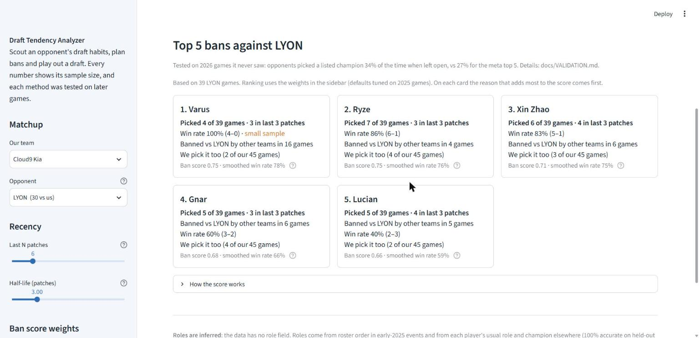

# Draft Tendency Analyzer

**Category 2: LoL macro scouting & draft management, for Cloud9 coaches.**

A draft-scouting dashboard built on GRID's official pro match data. Pick Cloud9 Kia and an opponent, and it shows what that team plays, what it protects early, what it bans, how it drafts against Cloud9, and which five bans hurt it most. Every ban comes with a plain-English reason and the sample size behind it. Because every 2025–26 LCK/LEC/LTA/LCS series in the data is played with Fearless Draft, it also shows how an opponent's drafting changes from game 1 to game 3+. A series planner then re-plans the next game's bans once you mark the champions already used.

**Demo video:** [link coming]

## Features

Tabs, in order: **Match prep**, Draft simulator, Opponent scouting, Insights, Ban plan, Fearless series, Against us.

- **Match prep** (first tab): the 60-second brief before a match. It names the tab with the details for every block.
  - **Records:** head-to-head and recent form, with the last 10 results.
  - **What they'll draft:** their most likely first-phase picks and their phase tells.
  - **Our ban plan:** the top 5 bans, strongest reason first.
  - **How to beat them:** the top 3 insight cards.
  - **Watch out:** what they ban against us and our own predictable habits.
  - **Proof:** one line showing the tendencies were tested on unseen games.
  - **Export pre-match report** downloads it as a one-page, text-only HTML file that prints cleanly to PDF.
- **Opponent scouting**: champion pool by (inferred) role with W-L records, a chart and a table that hides or greys out small samples. Also priority picks: their very first pick and first-round picks, split by whether they had first pick. Plus their bans, split into phase 1 and phase 2.
- **Against us**: what the opponent bans against Cloud9, and what Cloud9 bans against them, in head-to-head games only.
- **Early game** (in Opponent scouting): first blood, dragon, void grub, herald and tower per game from the event feeds, with game times, by team and by jungler champion.
  - **What's listed:** only patterns that held up when re-measured on later games, namely first-tower rate and the jungler–first-grub link. Most early-game habits didn't hold up, and an expander shows every number anyway. See [docs/MACRO.md](docs/MACRO.md).
- **Ban plan**: each card leads with the reason that adds most to the score (after the 2025 tuning), and the tab shows the backtest result.
- **Ban plan details**: the top 5 recommended bans as cards. Each card gives the reason (e.g. "Picked 7 of 39 games · 3 in last 3 patches", "Win rate 86% (6–1)", "Banned vs them in 4 games"), flags small samples, and shows the score. All score weights are sidebar sliders.
- **Fearless series**: the opponent's record, number of different champions and most-picked champions by game number (games 1 to 5, each with its sample size; games 4 and 5 are flagged as small samples), in Fearless series only. The **series planner** takes the champions each team has already used and shows what the opponent loses, their likely picks now, and a new ban plan.
- **Draft simulator**: play a 20-slot pro draft against the opponent:
  - **Setup:** first pick, side, game number in the series, Fearless-locked champions, and editable lineups and roles.
  - **Win chance:** the estimate for our team with an uncertainty band, beside team strength alone, plus a chart of how it moved during the draft.
  - **Best options for us:** the top 5 picks or bans, each with its shift in points, the main reason and the sample sizes behind it.
  - **Likely from them:** the opponent's 5 most likely next picks or bans. Checked on 897 past games, their actual pick was in this top 5 44% of the time, against 37% for the league meta alone.
  - **Framing:** each step is presented as what that choice shifts, not as a forecast. See [docs/SIMULATOR.md](docs/SIMULATOR.md).
- **Insights**: plain-language counter-strategies against the opponent, and the same analysis on our own team (self-scouting). The cards cover ban impact, Fearless carry-over, comfort dependency, side and first pick, and phase tells, with first-pick/first-ban predictability alongside.
  - **Evidence:** every card shows its evidence with a Wilson 90% interval, a confidence level and its sample size.
  - **Checked on later games:** each kind of pattern was re-measured on later games. Draft habits held up best (82% same direction), confident comfort and ban gaps partly, and side, first-pick and Fearless gaps not at all. Only kinds that held up make the "How to beat" list. See [docs/INSIGHTS.md](docs/INSIGHTS.md).
- **Win-probability model** (`src/draft_analyzer/model.py`, used by the simulator): estimates the win chance from team strength (Elo), side and the draft, and updates pick by pick on a partial draft. It uses Elo, side, champion meta, team and player comfort, and lane matchups. It was tested walk-forward, month by month, on 897 games it never saw: 65.2% accuracy, against 64.1% for team strength alone. That difference is not statistically real: once team strength is known, the draft adds no reliable accuracy. So it is meant to show how much each choice shifts the odds, not to forecast the winner. Full method and numbers: [docs/MODEL.md](docs/MODEL.md).
- Recency controls everywhere: last N patches (default 6) and a half-life for weighting recent games.

## What the tool shows

Numbers below are from the data as of patch 16.17. All of them are visible in the dashboard.

- **Cloud9 Kia is 4–9 against LYON in the last 6 patches** (13 games). In the same window LYON is 27–12, and Cloud9 is 23–22. Over all data Cloud9 is 90–52.
- **Cassiopeia has replaced Ziggs as the main respect ban against Cloud9.** Ziggs is still the most-banned champion against Cloud9 across all 142 games (41 bans). With recency weighting (half-life 3 patches) Cassiopeia leads at 39%, while Ziggs falls to 17%.
- **All 20 events use hard Fearless Draft.** In 568 multi-game series, no champion is ever picked twice in a series, by either team. This is detected from the picks, not assumed.
- **LYON is strongest in game 2 of Fearless series in the last 6 patches**: 11–2 (85%) in game 2 vs 8–5 (62%) in both game 1 and game 3+, with 13 games each. Over all data the gap is smaller (53% / 60% / 59%), so this is a recent trend on a small sample.

## Does it work?

Every claim was tested on games later than the ones used to build it. Full results: [docs/VALIDATION.md](docs/VALIDATION.md).

- **The Ban plan removes champions they actually play.** I backtested it on 439 games from 2026, each with only earlier data and with weights tuned on 2025. Of the champions it lists that a team didn't ban and left available, the opponent picked **33.8%**. That compares with **19.8%** for their own 5 most-picked champions and **26.9%** for the league meta. The gains are +14.0 pts and +6.9 pts (90% CI 12.3–15.7 and 4.9–8.9). Whether those champions also win them more games is not consistent (2025: no; 2026: +2–3 pts).
- **Their habits predict their next pick.** Across 8,970 picks in 897 games, the actual pick was in our top 5 **44%** of the time, against 37% for the meta alone. For bans it was **38%** against 26%.
- **Draft habits are stable.** "They take X early" and "they hold Y for the counter-pick" point the same way in later games **82%** of the time.
- **The draft does not predict the winner beyond team strength.** Team strength (Elo) alone gets 64% right on 897 later games, and adding the draft adds nothing reliable. That's why the simulator shows "what each choice shifts", not a forecast.
- **What didn't hold up, and isn't shown as advice:** win-rate gaps by side, first pick or Fearless carry-over, and most early-game habits.

## Screenshots





## Setup

Works on Windows, macOS and Linux. Requires **Python 3.13+** and git.

**1. Clone this repo and the GRID data repo next to each other.** The data repo is large, so check out only the LoL feeds and metadata:

```bash
git clone https://github.com/Dieu-Merci-IGABUKWISHAKA/draft-analyzer.git
git clone --filter=blob:none --sparse https://github.com/cloud9esports/stl-hackathon-2026-grid-starter.git
cd stl-hackathon-2026-grid-starter
git sparse-checkout set lol meta
cd ..
```

```
hackathon/
├── draft-analyzer/                     ← this repo
└── stl-hackathon-2026-grid-starter/    ← data (never committed here)
```

If the data lives somewhere else, set `STL_DATA_DIR` to its folder:

```bash
export STL_DATA_DIR=/path/to/stl-hackathon-2026-grid-starter       # macOS / Linux
```
```powershell
$env:STL_DATA_DIR = "C:\path\to\stl-hackathon-2026-grid-starter"   # Windows PowerShell
```

**2. Install, build the drafts table, run the dashboard:**

```bash
cd draft-analyzer
pip install -r requirements.txt
python scripts/check_setup.py                     # checks Python, packages, the data folder and caches
python src/draft_analyzer/drafts.py --rebuild     # streams all 745 series, about 40 s
python -m streamlit run app/streamlit_app.py      # opens http://localhost:8501
```

The build writes `data_cache/drafts.parquet` (gitignored). `python src/draft_analyzer/model.py` runs the walk-forward validation and saves the win-probability model (about 25 s), and `python -m pytest` runs the tests. A text version of the scouting report is `python notebooks/01_cloud9_scouting.py`.

`scripts/check_setup.py` prints what is fine and the exact next step for anything missing: the wrong Python version, packages not installed, the data folder not found, or caches not built yet. Missing caches are built on first use.

In PyCharm, the committed run configurations do the same:
- **Check setup**, **Rebuild drafts table** and **Dashboard (Streamlit)** cover the steps above.
- **Train draft model**, **Backtest ban plan**, **Tests** and **Cloud9 scouting report** run the rest.

## Methodology

**Data source: final snapshot over the event stream.** Picks and bans appear both as `team-picked/banned-character` events and in `seriesState.games[].draftActions`. We compared the two for all 745 series:
- **Agreement:** in 1,734 of 1,739 games they match exactly.
- **Gaps:** in the other 5, the event stream is missing 1–2 bans that the snapshot has.
- **Noise:** the stream also has 461 `!` undo events (44 abandoned draft attempts) and one rolled-back game.

The final snapshot already resolves all of that, so it is the source of truth. Patch, sides, team names and winners are joined from `meta/games.csv`, and champion names from `meta/characters.csv`, always on IDs.

**Draft slots.** `draft_order` is the standard pro draft slot (1–20: 6 bans, 6 picks, 4 bans, 4 picks), so a skipped ban leaves a gap rather than shifting later slots. Slots are keyed on the team that picks first, not on blue side. Until 2025 that team was always blue. In 243 games from 2026 it is red (2026's "first selection" rule). Two games logged slightly out of order are mapped by each team's k-th ban or pick.

**Inferred roles.** The data has no role field. In 6 early-2025 events, each team's roster order is top, jungle, mid, bot, support: signature junglers, ADCs and supports sit in the expected slot in at least 90% of games. In later events the order is fixed per team but is not role order. Those 6 events give labels, from which we learn how often each champion is played in each role and each player's usual role. Every other team-game gets the one-player-per-role assignment that best fits both. Holding out each labelled event in turn, the inference was correct for 100% of player-games.

**Recency.** "Last N patches" counts each team's own most recent patches with games. Within the window, a game is weighted 0.5^(patches ago / half-life), with a half-life of 3 patches by default.

**Win-rate smoothing.** Each champion's win rate gets 10 imaginary games at the team's overall win rate (a Bayesian prior). A 4–0 record therefore counts as strong but not 100%.

**Ban score.**
```
edge  = (smoothed win rate − 0.5) / 0.5            positive if they win on it, negative if they lose
score = recent pick rate × (pick + win_rate × edge)
      + banned_by_others × recent rate other teams ban it against them
positive scores × (1 − our_pick_penalty × our own recent pick rate)
```
Defaults: `win_rate` 3, `pick` 2, `banned_by_others` 1, `our_pick_penalty` 0, smoothing 10 games, minimum 2 picks. They were **tuned on 2025 games and tested on 2026 games** (backtest above). The earlier hand-set weights (`pick` 0, `banned_by_others` 0.25, `our_pick_penalty` 0.5, minimum 4 picks) were no better than the league meta. The win-rate term is signed, so a champion the opponent loses on scores lower.

**Fearless detection.** For each event we count champions re-picked later in the same multi-game series, by any team and by the same team. Zero repeats by any team means hard Fearless. All 20 events have zero, across 568 multi-game series. The series planner applies that rule: a champion used by either team is unavailable to both.

### Limitations

- **Small samples.** A team plays roughly 40 games in a 6-patch window and about 13 per game number in Fearless series. Every table shows its sample size, and records under 5 games are flagged.
- **Roles are inferred,** not recorded. One game (series 2782482 game 2) has a broken roster, so its 10 picks have no role.
- **Excluded or imperfect games:**
  - 3 finished games have no draft in their feed (2853511 G3, 2877343 G1, 2904099 G1).
  - 2 unfinished games are excluded (2782419 G2, and 2885343 G1).
  - 2885343 G1 is an invalidated replay that overwrote that series' final state, so its 2 real games are lost.
  - 13 games have 18 or 19 actions because bans were skipped.
- The ban score is a transparent heuristic, not a trained model. Its weights are judgment calls, which is why they are sliders.

## Tooling

- **PyCharm**: the project, the Python 3.13 interpreter, shared run configurations (`.idea/runConfigurations/`), and git. The `.idea/` folder is committed as evidence of the setup (per-user `workspace.xml` excluded).
- **Claude Code**, run in PyCharm's terminal, wrote the code. A person decided the questions and checked the results. See [docs/AI_WORKFLOW.md](docs/AI_WORKFLOW.md).
- Python libraries: pandas, pyarrow, zstandard, Streamlit, Plotly.

## Data and license

The match data is GRID's official data, provided for the Sky's The Limit 2026 hackathon under a license that forbids redistribution. **It is not included in this repo**, and nothing derived from it (the parquet cache) is committed. For the same reason the dashboard is not deployed publicly: it runs locally against your own copy of the data.

The code is released under the [MIT License](LICENSE).
